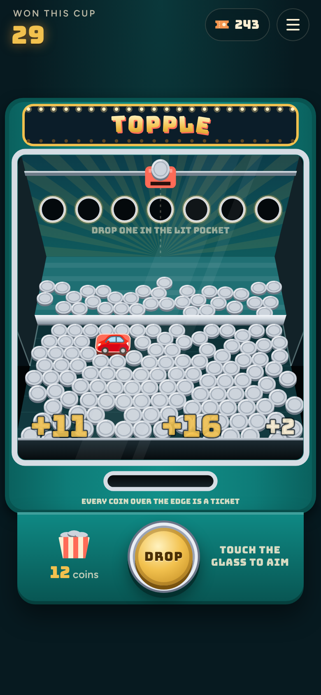
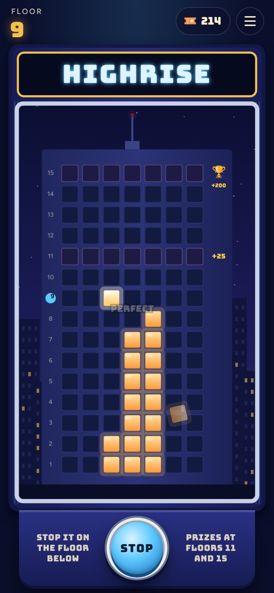
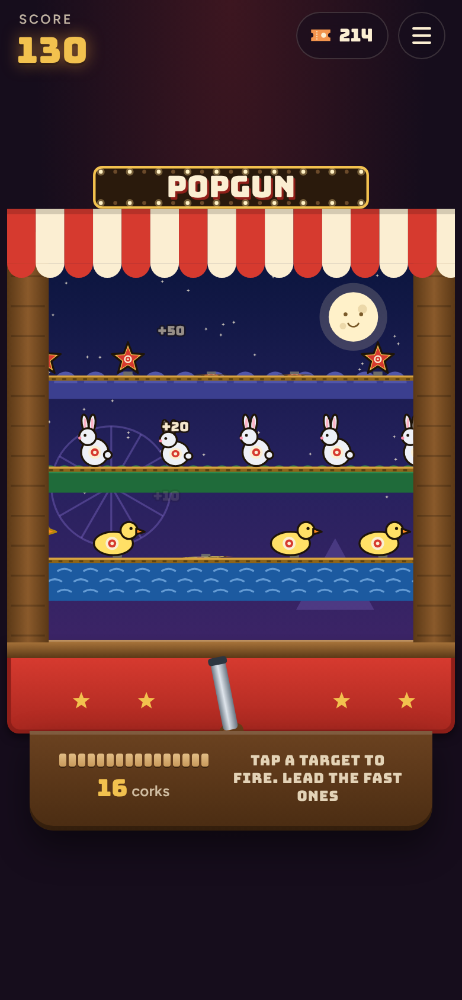
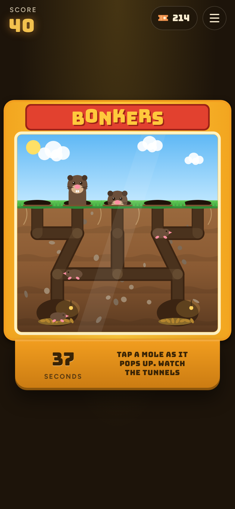
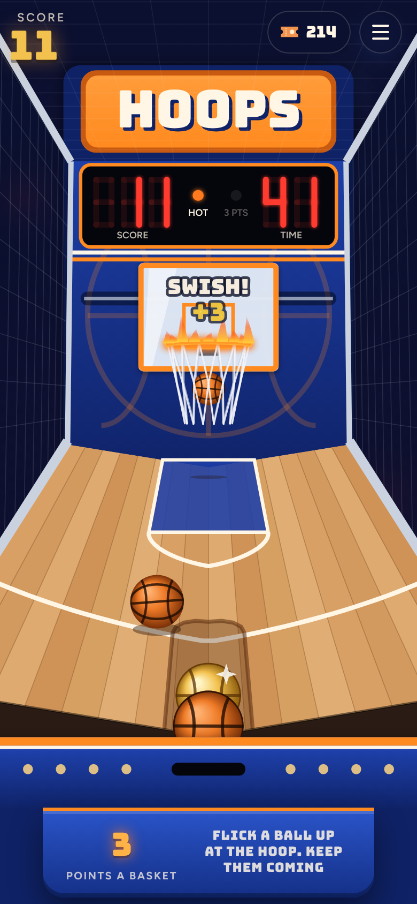

# Free Play

**Play it: [free-play.junkdrawer.works](https://free-play.junkdrawer.works/)**

**An arcade on your phone.** Walk onto the floor and pick a machine: Roll Up, a skee-ball lane; Tilt, three pinball tables; Clutch, a claw machine full of plush; Topple, a coin pusher; Highrise, a stacker; Popgun, a shooting gallery; Bonkers, a whack-a-mole; or Hoops, a basketball machine. Every machine is set to free play. The games pay out tickets into the same pocket, for the same prize counter at the back, and the claw and the coin pusher pay out prizes, straight onto the same shelf. There's room on the floor for more machines.

<p align="center">
  
  &nbsp;
  
  &nbsp;
  
</p>
<p align="center">
  
  &nbsp;
  
  &nbsp;
  
  &nbsp;
  
  &nbsp;
  
  &nbsp;
  
  &nbsp;
  
</p>

## How it plays

- **The floor** has a cabinet for each machine, showing what you've done on it: your best, today's card and how many days in a row you've played it, a cup still on the go on Topple, the plush you've won. Tap one to play. Every machine has a way back to the floor.
- **Tickets.** Roll Up pays one for every 10 points. Tilt pays one for every 10,000 on Classic and Space, and one for every 5,000 on Haunted House, the hard one. A fair game on either machine earns about 25 to 35, and they feed out of a slot at the end. Topple pays one for every coin pushed over its front edge, about 15 to 35 a cup, Highrise one for every floor built, Popgun one for every 20 points, Bonkers one for every 15, and Hoops one for every 4.
- **Plush and prizes.** Clutch is the one machine that pays in prizes instead of tickets: whatever its claw drops down the chute goes straight on your shelf. So does a prize pushed off Topple's deck.
- **The prize counter** is on the floor and in every machine's menus. Trade tickets for anything from a 5-ticket lollipop to a 2,500-ticket enormous unicorn, and it sits on your shelf next to your plush. Tapped the wrong one? For a few seconds after a trade, Undo gives the tickets back.
- No account and no server. Your tickets, prizes and scores stay in your browser. It works offline (on a connection that isn't answering, a page opens from the offline copy after four seconds), and installs to a phone's home screen as one app.

## Roll Up

Skee-ball, the boardwalk kind. Flick the ball up the lane, and it hops the ramp and drops into a ring worth 10 to 50, or a 100 up in the corners. A game is nine balls.

- **Drag, then flick.** Put a finger on the lane, from your end to a little past the red line, and the ball moves with it, so you can line it up anywhere across. (A touch further up the lane says to start on the ball.) Flick it up the lane, before the red line, to roll it; a slow drag just moves it, and a ball pushed over the line without a flick goes back.
- **How hard decides where it lands.** A gentle roll drops into the 20, firmer climbs to the 30, 40 and 50, and too hard sails over the rings into the 10. Too gentle and it doesn't make the jump at all, which scores nothing. A ball in the 10 says when it was too hard, or a bit soft.
- **The 100s want an angle.** They sit in the top corners: roll firmly and a little toward one.
- **Real bounces.** The ball is simulated in 3D, so it rattles off the ring lips and can bounce out of a ring or into a better one.
- **The golden ball.** One ball in every game is golden, and whatever it drops into scores double. You can see which one it is in the tray.
- **Today's card.** Nine called shots, the same for everyone that day, with that day's golden ball. The called hole glows; drop the ball in it for double, so a called shot with the golden ball is ×4. You get one go a day, a star for each call you hit, a count of the days in a row you've played, and a line to send someone. A new card comes at midnight.
- **The keyboard works too.** ← and → move the ball; hold Space to wind up and let go to roll. The meter by the ball turns red where a straight roll from the middle of the lane sails over the rings, and a faint tick marks the 50.

## Tilt

Three pinball tables. Classic is laid out and scored like an early-80s solid-state machine, Space is an early-90s table with a ramp, a lock and two-ball multiball, and Haunted House is the hard one, with ghosts and a trapdoor down to a basement. The ball runs on real-ish physics, measured in millimetres on a table the size of a real playfield, at three-quarter speed so it's easy to follow on a phone (the flippers stay full speed).

- **Flip** by tapping and holding the left or right half of the screen. On a keyboard: Z and / (or the Shift keys, or ← →).
- **Launch** by holding the Launch button and letting go: the longer you hold, the harder the shot. Keyboard: hold Space or ↓.
- **Nudge** with a quick swipe up, or ↑ or Space with the ball in play. Nudge too often and you get two Danger warnings; once more and the machine tilts: the flippers go dead and nothing else scores on that ball, bonus included.
- **The bonus** is counted, times the multiplier, when the ball drains. A ball that drains in the first few seconds is given back, once.
- Each table keeps its own top five scores.

### Classic

- **Skill shot.** The flashing top lane is worth 25,000 if the plunge drops into it. The flippers move it left and right.
- **Top lanes** A, B and C raise the bonus multiplier (up to 5×) and light the bumpers at 1,000 a pop.
- **Standups** on the orbit rail light the spinner at 1,000 a spin.
- **Drop targets** light an extra ball at the kickout in the middle; after that, a full bank is worth 25,000.
- **The bonus** counts up as you hit things.

### Space

- **The ramp** is a shot for the left flipper. It climbs over the playfield, turns round a hairpin and comes back down a wire to the left flipper, for 10,000. It lights the lock and raises the jackpot.
- **The upper flipper** works with the right one. Shoot the orbit with the right flipper and keep holding the button: the ball comes round onto the upper flipper. From there, shoot the dock under the ramp: with the lock lit the ball is locked there and another is served. Light the lock again and shoot the dock for two-ball **multiball**.
- **In multiball** the ramp scores the jackpot and the dock lights it again. The jackpot starts at 100,000 and each ramp made outside multiball adds 10,000, up to 250,000. Multiball starts with ten seconds of ball save.
- **Skill shot.** Launch softly onto the upper flipper and shoot the dock for 25,000.
- **Top lanes** U, F and O raise the bonus multiplier (up to 5×). The flippers move the lit lanes.
- **Planets.** Each ramp lights one. All eight light an extra ball at the left orbit, once a game; after that they're worth 50,000.
- **The bonus** is 2,000 for each ramp and 1,000 for each orbit made with that ball.

### Haunted House

- **The hard one.** Wider outlanes and shorter flippers than Classic, two pop bumpers, and five seconds of ball save (though it never runs out before the ball has first come down to the flippers).
- **Ghosts** glow now and then: one in each window of the house, one on the left orbit's rail and one on the right wall. Each glows for three seconds at a time, no more than two at once by themselves (each knock on the door wakes one more). Hit one while it glows to catch it: 5,000 for the first on a ball, 10,000 for the next, up to 25,000.
- **The front door** opens once two ghosts are caught (three the next time, then four): the candles under the house count them. While it's shut, a hard shot knocks on it for 1,000 and wakes a ghost.
- **The trapdoor** is behind the door. Shoot through the open door and the ball drops into the **basement**, a little table of its own under the house, with its own flippers and no outlanes. 10,000.
- **The coffin** in the basement has a lid of three drop targets. Knock all three off to light an extra ball, once a game; after that, a coffin is worth 50,000.
- **The stairs** in the basement's top corner take the ball back up for 10,000 (and the lit extra ball), out of the cellar door in the right inlane.
- **Skill shot.** The flashing top lane is worth 25,000 if the plunge drops into it. **Top lanes** R, I and P raise the bonus multiplier (up to 5×); the flippers move the lit lanes.
- **The bonus** is 2,000 for each ghost caught and 10,000 for each trip to the basement with that ball.

## Clutch

A claw machine, seen through the glass, heaped with plush: bears, chicks, frogs, ghosts, penguins and aliens, and now and then a lucky star. Goes are free, and there's no limit.

- **Hold the button** and the claw slides across the top of the box. **Let go** and it drops, closes its arms, lifts, carries whatever it caught back over the chute in the corner, and lets go. Anything that falls down the chute comes out of the prize door and is yours. A press too short to take the claw past the chute's clear wall isn't a go: it slides back and waits for a proper hold.
- **Aim for the middle.** The grab is judged as the arms close: a plush that sits square between them, with the hooks closing under its middle, usually makes it to the chute. One caught by its edge, or only round its sides, tends to slip off on the way, and some goes the claw just doesn't grip as hard, the way real ones are set. Over the middle of the plush on top of the heap, about two goes in five win something; dropped anywhere, about one in five.
- **Real heaps.** The plush are soft bodies piled up in a 2D physics world ([matter-js](https://brm.io/matter-js/)): the claw shoves them about on the way down, and a slipped one falls back wherever it lands. When the heap runs low, the machine is topped up between goes.
- **The keyboard works too.** Hold Space (or →) to move the claw, and let go to drop it.

## Topple

A coin pusher, looking down through the glass: a chrome pusher sliding in and out under the back wall, a deck heaped with silver coins, and the front edge they go over.

- **Touch the glass to aim** the chute along the top, and let go to drop a coin. (Or aim with the finger still and tap **Drop** for more in the same place.) A cup holds 20 coins, and the chute takes a moment to reload between them. The cup's done once its last coin is down and the pile goes quiet, and anything the pusher still pushes over while its card is up counts for it too.
- **How it pushes.** Coins land on the pusher and ride in and out with it. As it slides back, the back wall holds them, and the ones at the front get scraped off its lip onto the deck. As it slides forward, its face shoves the deck's coins along, and the ones at the front go over. Every coin over the front edge is a ticket, paid as it falls. The side walls stop short of the front, so coins pushed off the sides there go to the house.
- **The bonus.** Every so often the lights along the back wall chase along the row of pockets and stop on one. Drop a coin through the lit pocket while it's lit for a shower of eight coins across the pusher, sometimes with a gold one.
- **Gold coins** are worth ten tickets. **A prize** always sits on the deck somewhere, on a little card: push it over the edge and it goes on your shelf (a plastic watch, a toy car, a lucky keyring, a wind-up robot, or now and then a giant plastic gem). When one's gone, the attendant puts another on the pusher.
- **The deck stays as you left it.** The coins are kept between visits, so a pile left hanging over the edge is still hanging there next time, and a cup you didn't finish is waiting.
- **The keyboard works too.** ← and → move the chute; Space drops a coin.

## Highrise

A stacker: a tower against a night skyline, its windows the grid, seven across and fifteen floors high.

- **Stop the row.** A row of lit windows slides from side to side along the floor being built, setting off from somewhere new on each floor. Press **Stop** (or tap the tower, or press Space) to set it down. Windows with a lit window under them stay lit; the rest fall off, and the next row is only as wide as what stayed up.
- **It gets harder as it climbs.** Each floor moves a little faster than the one below, from about six windows a second at the bottom to thirteen at the top. Rows are three windows wide to start, two at most from floor 6, and one from floor 11.
- **Prizes.** Every floor built is a ticket. Floor 11 is the minor prize: take 25 more tickets and stop there, or keep going for the top. Build all fifteen and it pays 200 tickets and the Highrise trophy for your shelf. Keep going and stop short, and the 25 is gone (the floors still pay).

## Popgun

A carnival shooting gallery: a booth with a striped awning, a painted night fair behind, and three rows of tin targets running along brass rails, each row the other way from the one below.

- **Tap where you want the cork to go** and the popgun on the counter fires it there. (With a mouse, the pointer becomes the sights; on a keyboard, the arrows move them and Space fires.) A round is 20 corks, and the gun takes a moment to reload between them.
- **Aim ahead.** A cork takes about a third of a second to reach the back of the booth, and the targets keep moving, so a tap dead on a rabbit or a star lands behind it. Aim a little ahead of the ducks, half a rabbit ahead of the rabbits and a whole star ahead of the stars. The first few corks in a round that land just behind their target say so. Each row's motor surges a bit faster and a bit slower as it runs, so what worked a moment ago won't quite now.
- **What they're worth.** Ducks along the pond at the bottom are 10, rabbits in the middle 20, and the small fast stars up top 30. Now and then a golden duck comes along, worth 100, and a bell, which wins three more corks. Five hits in a row are worth 50 more. A target knocked flat stands up again once it's been round the back of the conveyor.
- A ticket for every 20 points, paid at the end of the round. (Try the moon.)

## Bonkers

Whack-a-mole, with the side of the cabinet made of glass. Five holes along a sunny lawn, and under it the ground in cross-section: the moles' tunnels, two snug burrows, and the moles running about in them.

- **Tap a mole as it pops up** to bonk it (or press 1 to 5 for the holes from the left). A round is 45 seconds.
- **Watch the tunnels.** Each mole picks a free hole and runs to it through the tunnels, stopping to sniff at the junctions, then climbs the shaft and pops up for a moment before ducking back down. You can see where they're going, if you can keep track of all of them.
- **Some only peek:** a nose out, and back down. A swing at a peek, at an empty hole, or at a mole still on its way up, is a miss: it costs 5 and ends your run.
- **A hard hat takes two bonks**, the first knocking it off, and is worth 30. **A golden mole** is worth 50, an ordinary one 10. Ten bonks in a row are worth 50 more.
- **It gets busier**: more moles, faster tunnels and quicker pops as the round goes on, and the last ten seconds are a frenzy. A bonked mole goes home to its burrow to see stars for a bit.
- A ticket for every 15 points, paid at the end of the round.

## Hoops

The basketball machine from the end of the row: a wooden ramp inside a net cage, a backboard and hoop at the far end, and four balls that roll back down to a pocket at your end.

- **Flick a ball up at the hoop** to shoot. How hard you flick is how far it goes, but it's forgiving: anything from a gentle flick to a brisk one goes about the right distance, and only well off either way falls short or flies long. Which way you flick is where it goes: point the flick at the hoop as you see it. (On a keyboard, the arrows aim and holding Space winds up a throw; let go when the meter's in the light.) A round is 45 seconds.
- **Keep them coming.** The balls come back down the ramp and line up in the pocket, and you can throw the next as soon as it's there (a flick let go just before it arrives waits for it). A little long still drops in off the board; short or wide clanks off the rim.
- **A basket is 2 points.** Twenty seconds in, the hoop starts to slide from side to side on its rail, so throw where it's going to be, and in the last ten seconds a basket is worth 3. A ball in the air when the buzzer goes still counts.
- **The gold ball** is worth double. **Three in a row** set the rim alight: a point more a basket until you miss.
- A ticket for every 4 points (two baskets), paid at the end of the round.

## Where the machines came from

Roll Up and Tilt each had their own address, roll-up.junkdrawer.works and tilt.junkdrawer.works. Those now send you here, keeping anything after the address (`?table=space`, say). A browser keeps each address's saves apart, so the first time Free Play opens, `shared/carry.js` asks each old address for its saves in a hidden frame (each one serves a `carry.html` that answers only Free Play), puts them where Free Play keeps them, and loads the page once more. Roll Up's tickets and prizes go into the arcade's wallet. If an old address doesn't answer, it tries again on the next two visits.

## Adding a machine

A machine is a folder with its own `index.html`. To put one on the floor:

1. Load `../shared/carry.js` first in its `<head>` and `../shared/arcade.css` before its own styles, and point its icon, manifest and fonts at the arcade's (`../icon.svg`, `../manifest.webmanifest`, `../fonts/`).
2. Pay tickets with `pay(n)` from `shared/wallet.js`, and show them coming out of the slot with `feed()` and `PAYOUT` from `shared/counter.js`; or, for a machine that pays in prizes the way Clutch does, put them on the shelf with `give(prize)` (and list them in `shared/prizes.js`). Open the prize counter with `openCounter()`. A machine with physics can use matter-js from `shared/matter.min.js`, as Clutch and Topple do.
3. Keep its own saves under a key starting `free-play.` and its name, link back to the floor (`../`), and register `../sw.js` for offline.
4. Give it a cabinet in `index.html` (a picture of it in `floor/`, which `tools/screenshots.mjs` draws), add its files to `sw.js`'s list, and give it a test.

## Running it

It's a static site: plain HTML, CSS and JavaScript, with no build step.

```sh
npx serve .                   # or any static file server, then open the printed address
npm test                      # unit tests in node, then the floor, the prize counter, the move and each machine in Chromium (needs Playwright)
node tools/screenshots.mjs    # redraws floor/*.jpg, docs/*.png and og.png
node tools/make-icons.mjs     # redraws the PNG icons from icon.svg
node tools/tune.mjs 60 space  # plays Tilt's tables with the autopilot and reports how balls drain and what they score
```

To put it online with GitHub Pages: **Settings → Pages → Build and deployment → Deploy from a branch**, then pick `main` and `/ (root)`. The `CNAME` file serves it at free-play.junkdrawer.works.

### Files

- `index.html`, `css/floor.css`, `js/floor.js`: the floor, with a cabinet for each machine and the prize counter at the back.
- `404.html`: the page for a mistyped address ("That machine isn't on the floor."), with the way to the floor and to each machine. GitHub Pages serves it for any address that isn't there, at any depth, and the offline copy does the same for a page it hasn't kept, so its styles are on the page and its links and fonts start from the site's root (`/hoops/`), the one place a path here isn't relative.
- `shared/wallet.js`: the one pocket of tickets and shelf of prizes every machine pays into and the counter spends from.
- `shared/counter.js`, `shared/arcade.css`: the prize counter, the ticket dispenser at the end of a game, and the toast, for every page.
- `shared/prizes.js`: what's at the prize counter and what it costs, the plush Clutch gives out, the prizes on Topple's deck and Highrise's trophy.
- `shared/matter.min.js`: matter-js, the 2D physics Clutch and Topple run on (MIT licence, kept here so it works offline).
- `shared/carry.js`: brings saves over from the machines' old addresses on the first visit.
- `shared/insets.js`: how far a phone's notch, rounded corners and home indicator reach in, so each machine keeps its cabinet clear of them.
- `roll-up/`: Roll Up. `js/physics.js` is the machine in centimetres and the ball on it, `js/scene.js` draws it in perspective, `js/daily.js` is today's card, `js/app.js` runs the game and `js/sound.js` makes every sound with Web Audio.
- `tilt/`: Tilt. `js/physics.js` and `js/game.js` are the machine every table shares, `js/tables/` holds the three tables (layout, rules, drawing and skins each), and `js/main.js` wires it all to the page.
- `clutch/`: Clutch. `js/machine.js` is the box, the heap and the claw in millimetres, run by matter-js, `js/draw.js` draws the cabinet and gives each plush its face, `js/app.js` runs the button, the goes and the win card, and `js/sound.js` makes the noises with Web Audio.
- `hoops/`: Hoops. `js/court.js` is the balls, the rim, the board and the ramp in centimetres, and the round, with a clock that only moves when it's told to, `js/draw.js` draws the machine in perspective, `js/app.js` turns flicks into throws and runs the round and the tickets, and `js/sound.js` makes the noises.
- `bonkers/`: Bonkers. `js/burrow.js` is the tunnels, the moles and the mallet, with a clock that only moves when it's told to, `js/draw.js` draws the cabinet and the ground in cross-section, `js/app.js` runs the round and the tickets, and `js/sound.js` makes the noises.
- `popgun/`: Popgun. `js/gallery.js` is the rows, the corks and the score, with a clock that only moves when it's told to, `js/draw.js` draws the booth and the tin targets, `js/app.js` runs the aiming, the round and the tickets, and `js/sound.js` makes the noises.
- `highrise/`: Highrise. `js/tower.js` is the rules, with no clock of its own, `js/draw.js` draws the tower and the city, `js/app.js` keeps time and runs the stop button and the prizes, and `js/sound.js` makes the noises.
- `topple/`: Topple. `js/machine.js` is the pusher (the shelf, in the code), the deck and the coins seen from above, in millimetres, run by matter-js, `js/draw.js` puts it in perspective with a simple camera, `js/app.js` runs the chute, the cup and what comes over the edge, and `js/sound.js` makes the noises.
- `floor/`: the pictures on the cabinets' screens.
- `docs/`: the README's pictures of each machine and the counter on a phone.
- `tools/`: `screenshots.mjs` draws the pictures (`floor/*.jpg`, `docs/*.png` and `og.png`) from the pages themselves, `make-icons.mjs` draws the PNG icons from `icon.svg` and `tools/icon-full-bleed.svg` (the one with square corners, for phones that round them), and `tune.mjs` plays Tilt's tables with the autopilot and reports how balls drain and what they score.
- `test/`: unit tests for the arcade and each machine (`*.test.mjs`), and browser tests for the floor (`e2e.mjs`), the prize counter on every page (`counter.e2e.mjs`), the move (`carry.e2e.mjs`) and each machine.
- `fonts/`: Bungee, Bungee Outline and Figtree (SIL Open Font License), served from here so nothing loads from elsewhere.
- `sw.js`: keeps a copy of the floor and every machine for playing offline.
