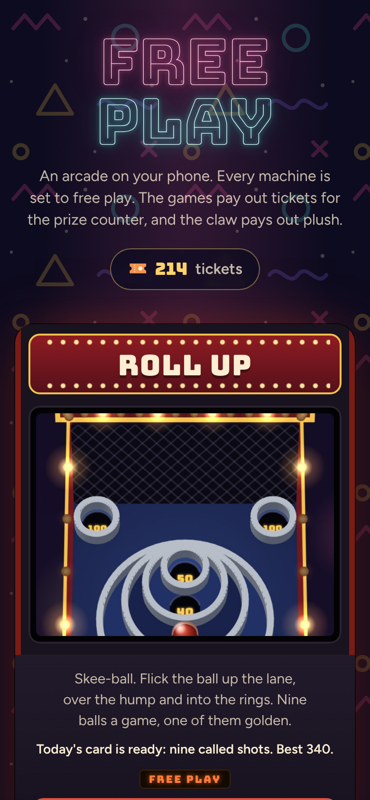
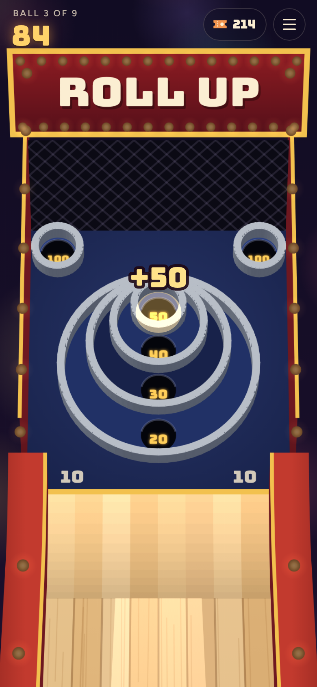
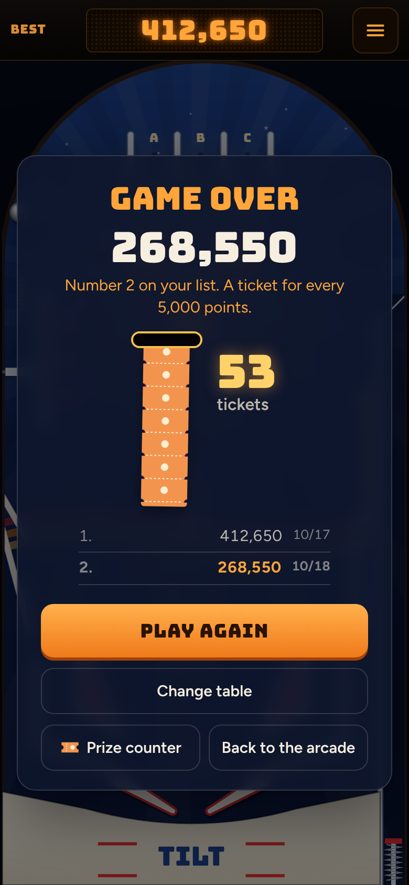
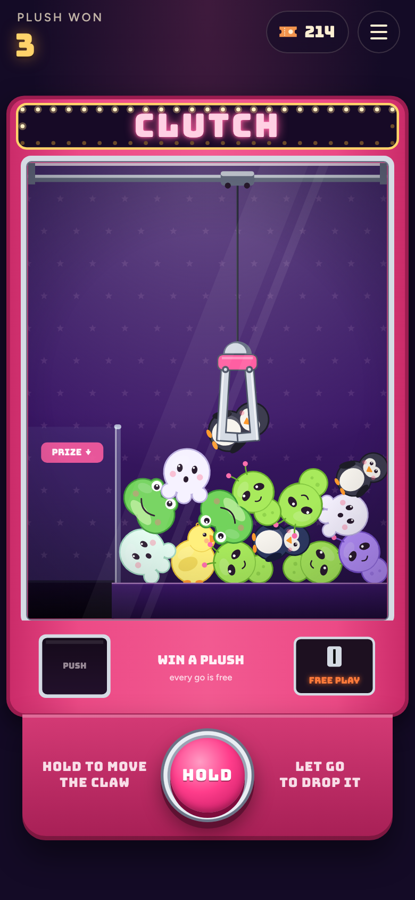
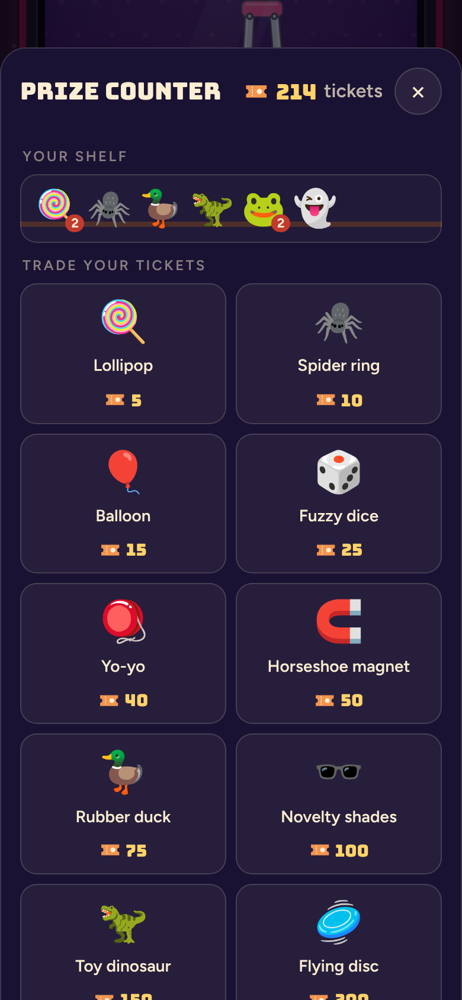

# Free Play

**Play it: [free-play.junkdrawer.works](https://free-play.junkdrawer.works/)**

**An arcade on your phone.** Walk onto the floor and pick a machine: Roll Up, a skee-ball lane; Tilt, three pinball tables; or Clutch, a claw machine full of plush. Every machine is set to free play. The games pay out tickets into the same pocket, for the same prize counter at the back, and the claw pays out plush, straight onto the same shelf. There's room on the floor for more machines.

<p align="center">
  
  &nbsp;
  
  &nbsp;
  
</p>
<p align="center">
  
  &nbsp;
  
</p>

## How it plays

- **The floor** has a cabinet for each machine, showing what you've done on it: your best, whether you've played today's card, the plush you've won. Tap one to play. Every machine has a way back to the floor.
- **Tickets.** Roll Up pays one for every 10 points. Tilt pays one for every 10,000 on Classic and Space, and one for every 5,000 on Haunted House, the hard one. A fair game on either machine earns about 25 to 35, and they feed out of a slot at the end.
- **Plush.** Clutch is the one machine that pays in prizes instead of tickets: whatever its claw drops down the chute goes straight on your shelf.
- **The prize counter** is on the floor and in every machine's menus. Trade tickets for anything from a 5-ticket lollipop to a 2,500-ticket enormous unicorn, and it sits on your shelf next to your plush.
- No account and no server. Your tickets, prizes and scores stay in your browser. It works offline, and installs to a phone's home screen as one app.

## Roll Up

Skee-ball, the boardwalk kind. Flick the ball up the lane, and it hops the ramp and drops into a ring worth 10 to 50, or a 100 up in the corners. A game is nine balls.

- **Drag, then flick.** Put a finger on the lane and the ball moves with it, so you can line it up anywhere across. Flick up the lane to roll; a slow drag just moves it.
- **How hard decides where it lands.** A gentle roll drops into the 20, firmer climbs to the 30, 40 and 50, and too hard sails over the rings into the 10. Too gentle and it doesn't make the jump at all, which scores nothing.
- **The 100s want an angle.** They sit in the top corners: roll firmly and a little toward one.
- **Real bounces.** The ball is simulated in 3D, so it rattles off the ring lips and can bounce out of a ring or into a better one.
- **The golden ball.** One ball in every game is golden, and whatever it drops into scores double. You can see which one it is in the tray.
- **Today's card.** Nine called shots, the same for everyone that day, with that day's golden ball. The called hole glows; drop the ball in it for double, so a called shot with the golden ball is ×4. You get one go a day, a star for each call you hit, a count of the days in a row you've played, and a line to send someone. A new card comes at midnight.
- **The keyboard works too.** ← and → move the ball; hold Space to wind up and let go to roll.

## Tilt

Three pinball tables. Classic is laid out and scored like an early-80s solid-state machine, Space is an early-90s table with a ramp, a lock and two-ball multiball, and Haunted House is the hard one, with ghosts and a trapdoor down to a basement. The ball runs on real-ish physics, measured in millimetres on a table the size of a real playfield, at three-quarter speed so it's easy to follow on a phone (the flippers stay full speed).

- **Flip** by tapping and holding the left or right half of the screen. On a keyboard: Z and / (or the Shift keys, or ← →).
- **Launch** by holding the Launch button and letting go: the longer you hold, the harder the shot. Keyboard: hold Space or ↓.
- **Nudge** with a quick swipe up, or ↑ or Space with the ball in play. Nudge too often and you get a Danger warning, then the machine tilts: the flippers go dead and you lose the bonus.
- **The bonus** is counted, times the multiplier, when the ball drains. A ball that drains in the first few seconds is given back, once.
- Each table keeps its own top five scores.

### Classic

- **Skill shot.** The flashing top lane is worth 25,000 if the plunge drops into it. The flippers move it left and right.
- **Top lanes** A, B and C raise the bonus multiplier (up to 5×) and light the bumpers at 1,000 a pop.
- **Standups** on the orbit rail light the spinner at 1,000 a spin.
- **Drop targets** light an extra ball at the kickout in the middle; after that, a full bank is worth 25,000.
- **The bonus** counts up as you hit things.

### Space

- **The ramp** is a shot for the left flipper. It climbs over the playfield, turns round a hairpin and comes back down a wire to the left flipper, for 10,000. It lights the lock and raises the jackpot.
- **The upper flipper** works with the right one. Shoot the orbit with the right flipper and keep holding the button: the ball comes round onto the upper flipper. From there, shoot the dock under the ramp: with the lock lit the ball is locked there and another is served. Light the lock again and shoot the dock for two-ball **multiball**.
- **In multiball** the ramp scores the jackpot and the dock lights it again. The jackpot starts at 100,000 and each ramp made outside multiball adds 10,000, up to 250,000. Multiball starts with ten seconds of ball save.
- **Skill shot.** Launch softly onto the upper flipper and shoot the dock for 25,000.
- **Top lanes** U, F and O raise the bonus multiplier (up to 5×). The flippers move the lit lanes.
- **Planets.** Each ramp lights one. All eight light an extra ball at the left orbit, once a game; after that they're worth 50,000.
- **The bonus** is 2,000 for each ramp and 1,000 for each orbit made with that ball.

### Haunted House

- **The hard one.** Wider outlanes and shorter flippers than Classic, two pop bumpers, and five seconds of ball save (though it never runs out before the ball has first come down to the flippers).
- **Ghosts** glow now and then: one in each window of the house, one on the left orbit's rail and one on the right wall. Each glows for three seconds at a time, no more than two at once by themselves (each knock on the door wakes one more). Hit one while it glows to catch it: 5,000 for the first on a ball, 10,000 for the next, up to 25,000.
- **The front door** opens once two ghosts are caught (three the next time, then four): the candles under the house count them. While it's shut, a hard shot knocks on it for 1,000 and wakes a ghost.
- **The trapdoor** is behind the door. Shoot through the open door and the ball drops into the **basement**, a little table of its own under the house, with its own flippers and no outlanes. 10,000.
- **The coffin** in the basement has a lid of three drop targets. Knock all three off to light an extra ball, once a game; after that, a coffin is worth 50,000.
- **The stairs** in the basement's top corner take the ball back up for 10,000 (and the lit extra ball), out of the cellar door in the right inlane.
- **Skill shot.** The flashing top lane is worth 25,000 if the plunge drops into it. **Top lanes** R, I and P raise the bonus multiplier (up to 5×); the flippers move the lit lanes.
- **The bonus** is 2,000 for each ghost caught and 10,000 for each trip to the basement with that ball.

## Clutch

A claw machine, seen through the glass, heaped with plush: bears, chicks, frogs, ghosts, penguins and aliens, and now and then a lucky star. Goes are free, and there's no limit.

- **Hold the button** and the claw slides across the top of the box. **Let go** and it drops, closes its arms, lifts, carries whatever it caught back over the chute in the corner, and lets go. Anything that falls down the chute comes out of the prize door and is yours.
- **Aim for the middle.** The grab is judged as the arms close: a plush that sits square between them, with the hooks closing under its middle, usually makes it to the chute. One caught by its edge, or only round its sides, tends to slip off on the way, and some goes the claw just doesn't grip as hard, the way real ones are set. Over the middle of the plush on top of the heap, about two goes in five win something; dropped anywhere, about one in five.
- **Real heaps.** The plush are soft bodies piled up in a 2D physics world ([matter-js](https://brm.io/matter-js/)): the claw shoves them about on the way down, and a slipped one falls back wherever it lands. When the heap runs low, the machine is topped up between goes.
- **The keyboard works too.** Hold Space (or →) to move the claw, and let go to drop it.

## Where the machines came from

Roll Up and Tilt each had their own address, roll-up.junkdrawer.works and tilt.junkdrawer.works. Those now send you here, keeping anything after the address (`?table=space`, say). A browser keeps each address's saves apart, so the first time Free Play opens, `shared/carry.js` asks each old address for its saves in a hidden frame (each one serves a `carry.html` that answers only Free Play), puts them where Free Play keeps them, and loads the page once more. Roll Up's tickets and prizes go into the arcade's wallet. If an old address doesn't answer, it tries again on the next two visits.

## Adding a machine

A machine is a folder with its own `index.html`. To put one on the floor:

1. Load `../shared/carry.js` first in its `<head>` and `../shared/arcade.css` before its own styles, and point its icon, manifest and fonts at the arcade's (`../icon.svg`, `../manifest.webmanifest`, `../fonts/`).
2. Pay tickets at the end of a game with `pay(n)` from `shared/wallet.js`, and show them coming out of the slot with `feed()` and `PAYOUT` from `shared/counter.js`; or, for a machine that pays in prizes the way Clutch does, put them on the shelf with `give(prize)` (and list them in `shared/prizes.js`). Open the prize counter with `openCounter()`.
3. Keep its own saves under a key starting `free-play.` and its name, link back to the floor (`../`), and register `../sw.js` for offline.
4. Give it a cabinet in `index.html` (a picture of it in `floor/`, which `tools/screenshots.mjs` draws), add its files to `sw.js`'s list, and give it a test.

## Running it

It's a static site: plain HTML, CSS and JavaScript, with no build step.

```sh
npx serve .                   # or any static file server, then open the printed address
npm test                      # unit tests in node, then the floor, the move, Roll Up, Tilt and Clutch in Chromium (needs Playwright)
node tools/screenshots.mjs    # redraws floor/*.jpg, docs/*.png and og.png
node tools/make-icons.mjs     # redraws the PNG icons from icon.svg
node tools/tune.mjs 60 space  # plays Tilt's tables with the autopilot and reports how balls drain and what they score
```

To put it online with GitHub Pages: **Settings → Pages → Build and deployment → Deploy from a branch**, then pick `main` and `/ (root)`. The `CNAME` file serves it at free-play.junkdrawer.works.

### Files

- `index.html`, `css/floor.css`, `js/floor.js`: the floor, with a cabinet for each machine and the prize counter at the back.
- `shared/wallet.js`: the one pocket of tickets and shelf of prizes every machine pays into and the counter spends from.
- `shared/counter.js`, `shared/arcade.css`: the prize counter, the ticket dispenser at the end of a game, and the toast, for every page.
- `shared/prizes.js`: what's at the prize counter and what it costs, and the plush Clutch gives out.
- `shared/carry.js`: brings saves over from the machines' old addresses on the first visit.
- `roll-up/`: Roll Up. `js/physics.js` is the machine in centimetres and the ball on it, `js/scene.js` draws it in perspective, `js/daily.js` is today's card, `js/app.js` runs the game and `js/sound.js` makes every sound with Web Audio.
- `tilt/`: Tilt. `js/physics.js` and `js/game.js` are the machine every table shares, `js/tables/` holds the three tables (layout, rules, drawing and skins each), and `js/main.js` wires it all to the page.
- `clutch/`: Clutch. `js/machine.js` is the box, the heap and the claw in millimetres, run by matter-js (`js/matter.min.js`, MIT licence, kept here so it works offline), `js/draw.js` draws the cabinet and gives each plush its face, `js/app.js` runs the button, the goes and the win card, and `js/sound.js` makes the noises with Web Audio.
- `floor/`: the pictures on the cabinets' screens.
- `test/`: unit tests for the arcade, Roll Up, Tilt and Clutch (`*.test.mjs`), and browser tests for the floor (`e2e.mjs`), the move (`carry.e2e.mjs`), Roll Up, Tilt and Clutch.
- `fonts/`: Bungee, Bungee Outline and Figtree (SIL Open Font License), served from here so nothing loads from elsewhere.
- `sw.js`: keeps a copy of the floor and every machine for playing offline.
